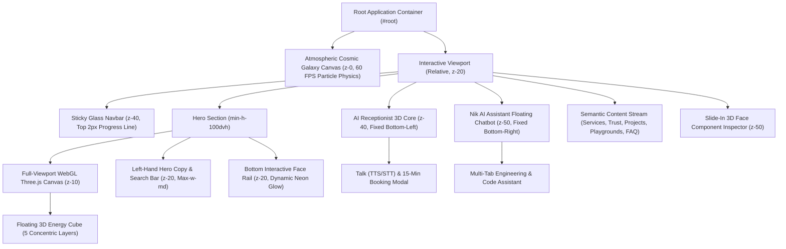
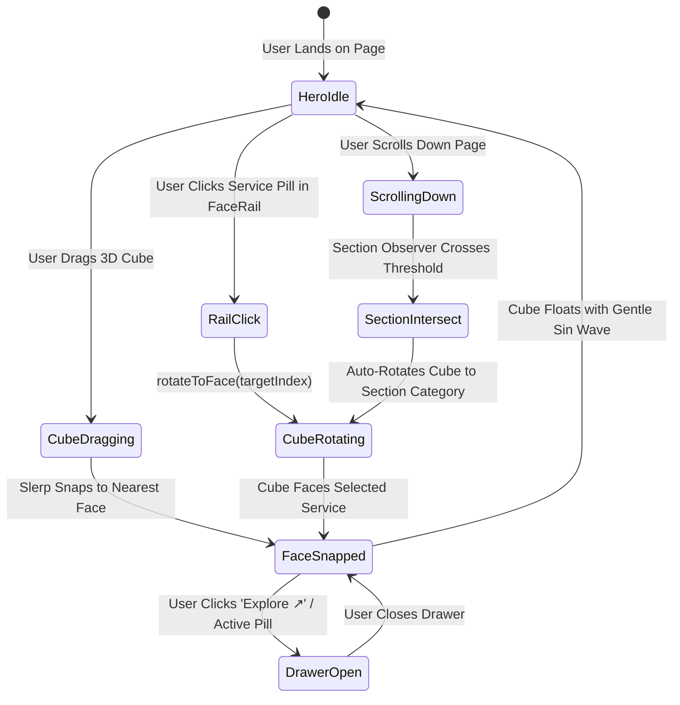

# Nikneuron Futuristic Design System & Master Implementation Bible

> **Theme Identity:** Deep Void Cyber-Futurism  
> **Core Aesthetic:** Zero-Gravity Translucent Glassmorphism, Electric Cyan (`#4fd8ff`) & Hot Pink (`#ff5aa5`) Neon Accents, Procedural GPU GLSL Plasma, Real-Time Web Audio Synthesized Telemetry, and Tactile 3D Spatial Navigation.  
> **Engineering Target:** Sub-second First Contentful Paint (<0.6s), 60 FPS WebGL rendering, Zero external audio assets, and Full WCAG AAA Contrast & Reduced-Motion Accessibility.

---

## Master Table of Contents
1. [System Architecture & Visual Hierarchy](#1-system-architecture--visual-hierarchy)
2. [Design Tokens & Master Palette](#2-design-tokens--master-palette)
3. [Typography System & Hierarchy](#3-typography-system--hierarchy)
4. [Complete Tailwind & CSS Engine](#4-complete-tailwind--css-engine)
5. [Atmospheric Background Engine (60 FPS Cosmic Galaxy Canvas)](#5-atmospheric-background-engine-60-fps-cosmic-galaxy-canvas)
6. [3D Energy Cube: Complete Mathematics & Production Shaders](#6-3d-energy-cube-complete-mathematics--production-shaders)
7. [Procedural 512x512 Cybernetic Face Canvas Textures](#7-procedural-512x512-cybernetic-face-canvas-textures)
8. [Tactile Web Audio Synthesizer Engine (Zero-Asset Haptics)](#8-tactile-web-audio-synthesizer-engine-zero-asset-haptics)
9. [Interactive Navigation Ecosystem](#9-interactive-navigation-ecosystem)
10. [High-Converting UI Primitives & Glassmorphism Surfaces](#10-high-converting-ui-primitives--glassmorphism-surfaces)
11. [Z-Index Layering Registry & Spatial Layout Rules](#11-z-index-layering-registry--spatial-layout-rules)
12. [Motion Physics, Easing Curves & Performance Playbook](#12-motion-physics-easing-curves--performance-playbook)
13. [End-to-End Boilerplate Implementation Guide](#13-end-to-end-boilerplate-implementation-guide)

---

## 1. System Architecture & Visual Hierarchy

Nikneuron merges a 2D web application with a 3D real-time WebGL space. Below is the structural layout mapping:



### 1.1 State Synchronization Machine

The 3D cube orientation, current section scroll spy, and slide-in drawer stay synchronized through a single global state store:



---

## 2. Design Tokens & Master Palette

### 2.1 Core Palette

```
  #020308          #050612          #0a1432          #4fd8ff          #ff5aa5          #e8fbff
┌──────────────┐ ┌──────────────┐ ┌──────────────┐ ┌──────────────┐ ┌──────────────┐ ┌──────────────┐
│  Void Deep   │ │  Void Base   │ │ Void Surface │ │Electric Cyan │ │  Hot Pink    │ │  White Ice   │
│  (Deep Dark) │ │ (Background) │ │ (Glass Surface││(Primary Neon)│ │(Accent Punch)│ │(Core Specular)
└──────────────┘ └──────────────┘ └──────────────┘ └──────────────┘ └──────────────┘ └──────────────┘
```

| Token Name | Hex Code | RGBA / Value | WCAG Contrast on `#050612` | Purpose |
| :--- | :--- | :--- | :--- | :--- |
| **`void-deep`** | `#020308` | `rgba(2, 3, 8, 1)` | N/A | Deepest ground layer, backdrop tint |
| **`void`** | `#050612` | `rgba(5, 6, 18, 1)` | N/A | Primary canvas & body background |
| **`void-surface`** | N/A | `rgba(10, 20, 50, 0.45)` | N/A | Glass card surfaces, pill bars |
| **`void-hover`** | N/A | `rgba(16, 28, 68, 0.65)` | N/A | Interactive surface hover highlight |
| **`cyan-electric`**| `#4fd8ff` | `rgba(79, 216, 255, 1)` | 11.2:1 (AAA) | Brand signature, active tabs, glowing borders |
| **`cyan-glow`** | N/A | `rgba(79, 216, 255, 0.45)`| N/A | High-energy multi-stop drop-shadows |
| **`cyan-subtle`** | N/A | `rgba(79, 216, 255, 0.12)`| N/A | Soft background fills behind icons |
| **`pink-accent`** | `#ff5aa5` | `rgba(255, 90, 165, 1)` | 6.8:1 (AA) | Secondary accent, interactive selection |
| **`pink-glow`** | N/A | `rgba(255, 90, 165, 0.5)` | N/A | High-contrast neon pulse effects |
| **`ice`** | `#e8fbff` | `rgba(232, 251, 255, 1)` | 17.1:1 (AAA) | Core plasma highlights, white-hot points |
| **`blue-deep`** | `#0a3cff` | `rgba(10, 60, 255, 1)` | 3.4:1 | Sub-surface shader foundation |
| **`blue-electric`**| `#2979ff` | `rgba(41, 121, 255, 1)` | 5.2:1 (AA) | Secondary borders, telemetry badges |

### 2.2 Text Hierarchy Tokens

| Token | Hex Value | Weight | Role |
| :--- | :--- | :--- | :--- |
| **`text-primary`** | `#f1f7ff` | Bold / SemiBold | Primary headings, active labels, critical values |
| **`text-secondary`** | `#b8cae4` | Regular / Medium | Body copy, technical descriptions, feature lists |
| **`text-dim`** | `#8ba1c2` | Medium | Footnotes, shortcut tags, timestamps, coordinates |

### 2.3 Vertical Service Signature Accents

Each service in Nikneuron carries a unique neon color theme. When active or hovered, buttons, borders, beacon dots, and ambient glows dynamically adapt:

```typescript
export const SERVICES_CONFIG = [
  {
    id: 'ui-ux-web',
    faceIndex: 0,
    title: 'UI/UX & Web Dev',
    accentColor: '#ff5aa5',       // Hot Pink
    glowColor: 'rgba(255, 90, 165, 0.45)',
  },
  {
    id: 'batch-mail',
    faceIndex: 1,
    title: 'Batch Mail & Marketing',
    accentColor: '#a78bfa',       // Cyber Purple
    glowColor: 'rgba(167, 139, 250, 0.45)',
  },
  {
    id: 'custom-software',
    faceIndex: 2,
    title: 'Custom Software & ERP',
    accentColor: '#fbbf24',       // Solar Amber
    glowColor: 'rgba(251, 191, 36, 0.45)',
  },
  {
    id: 'support-growth',
    faceIndex: 3,
    title: 'Support & Growth',
    accentColor: '#34d399',       // Neon Emerald
    glowColor: 'rgba(52, 211, 153, 0.45)',
  },
  {
    id: 'ai-receptionist',
    faceIndex: 4,
    title: 'AI Receptionist & Voice',
    accentColor: '#4fd8ff',       // Electric Cyan
    glowColor: 'rgba(79, 216, 255, 0.45)',
  },
  {
    id: 'ai-chat-automation',
    faceIndex: 5,
    title: 'AI & Chat Automation',
    accentColor: '#60a5fa',       // Sky Blue
    glowColor: 'rgba(96, 165, 250, 0.45)',
  },
] as const;
```

---

## 3. Typography System & Hierarchy

```
DISPLAY:   UNBOUNDED (Bold, Geometric, Futuristic)
BODY:      MANROPE (Sub-pixel Clear, High Legibility)
TELEMETRY: MONOSPACE (System Mono / JetBrains Mono)
```

### 3.1 Fluid Type Scale

```css
/* Responsive typography clamp values */
--font-hero: clamp(1.75rem, 4vw + 1rem, 3.25rem);      /* 28px -> 52px */
--font-h1: clamp(1.5rem, 3vw + 0.75rem, 2.5rem);        /* 24px -> 40px */
--font-h2: clamp(1.25rem, 2vw + 0.5rem, 1.875rem);      /* 20px -> 30px */
--font-h3: clamp(1rem, 1.2vw + 0.4rem, 1.35rem);        /* 16px -> 21.6px */
--font-body: clamp(0.8125rem, 0.5vw + 0.65rem, 0.9375rem); /* 13px -> 15px */
--font-telemetry: clamp(0.6875rem, 0.3vw + 0.55rem, 0.75rem); /* 11px -> 12px */
```

### 3.2 Character Tracking & Leading Rules
- **Display Headings (`font-display`)**: `letter-spacing: -0.025em`, `line-height: 1.15`.
- **Telemetry Badges (`font-mono`)**: `letter-spacing: +0.18em`, `text-transform: uppercase`, `font-weight: 700`.
- **Prose Paragraphs (`font-body`)**: `letter-spacing: -0.005em`, `line-height: 1.625`.

---

## 4. Complete Tailwind & CSS Engine

### 4.1 Production `tailwind.config.js`

```javascript
/** @type {import('tailwindcss').Config} */
export default {
  content: ['./index.html', './src/**/*.{js,ts,jsx,tsx}'],
  theme: {
    extend: {
      colors: {
        void: {
          DEFAULT: '#050612',
          deep: '#020308',
          surface: 'rgba(10, 20, 50, 0.45)',
          hover: 'rgba(16, 28, 68, 0.65)',
        },
        cyan: {
          electric: '#4fd8ff',
          glow: 'rgba(79, 216, 255, 0.45)',
          subtle: 'rgba(79, 216, 255, 0.12)',
        },
        ice: '#e8fbff',
        text: {
          primary: '#f1f7ff',
          secondary: '#b8cae4',
          dim: '#8ba1c2',
        },
        blue: {
          deep: '#0a3cff',
          electric: '#2979ff',
        },
        pink: {
          accent: '#ff5aa5',
          glow: 'rgba(255, 90, 165, 0.5)',
        },
      },
      fontFamily: {
        display: ['Unbounded', 'sans-serif'],
        body: ['Manrope', 'sans-serif'],
        mono: ['ui-monospace', 'SFMono-Regular', 'Menlo', 'Monaco', 'Consolas', 'monospace'],
      },
      boxShadow: {
        'cyan-glow': '0 0 25px rgba(79, 216, 255, 0.4)',
        'pink-glow': '0 0 25px rgba(255, 90, 165, 0.45)',
        'glass': '0 20px 50px rgba(0, 0, 0, 0.8), 0 0 30px rgba(79, 216, 255, 0.15)',
        'glass-hover': '0 25px 60px rgba(0, 0, 0, 0.9), 0 0 40px rgba(79, 216, 255, 0.25)',
      },
      animation: {
        'pulse-subtle': 'pulseSubtle 3s ease-in-out infinite alternate',
        'spin-slow': 'spin 18s linear infinite',
        'shimmer': 'shimmer 2.2s infinite',
        'ping-slow': 'ping 2.5s cubic-bezier(0, 0, 0.2, 1) infinite',
      },
      keyframes: {
        pulseSubtle: {
          '0%': { opacity: '0.8', transform: 'scale(0.99)' },
          '100%': { opacity: '1', transform: 'scale(1.01)' },
        },
        shimmer: {
          '100%': { transform: 'translateX(100%)' },
        },
      },
    },
  },
  plugins: [],
};
```

### 4.2 Production `src/index.css`

```css
@import '@fontsource/manrope/400.css';
@import '@fontsource/manrope/600.css';
@import '@fontsource/manrope/700.css';
@import '@fontsource/unbounded/700.css';

@tailwind base;
@tailwind components;
@tailwind utilities;

@layer base {
  :root {
    --void-bg: #050612;
    --cyan-electric: #4fd8ff;
    --pink-accent: #ff5aa5;
  }

  html {
    scroll-behavior: smooth;
    overflow-x: hidden;
    width: 100%;
    background-color: var(--void-bg);
    color: #f1f7ff;
    font-family: 'Manrope', system-ui, -apple-system, sans-serif;
  }

  /* Accessible Focus Rings */
  :focus-visible {
    outline: 2px solid #4fd8ff;
    outline-offset: 3px;
  }

  /* Cyber Selection Highlight */
  ::selection {
    background: #ff5aa5;
    color: #050612;
  }

  /* High-Tech Slim Scrollbar */
  ::-webkit-scrollbar {
    width: 5px;
    height: 5px;
  }
  ::-webkit-scrollbar-track {
    background: rgba(2, 3, 8, 0.8);
  }
  ::-webkit-scrollbar-thumb {
    background: rgba(79, 216, 255, 0.3);
    border-radius: 9999px;
  }
  ::-webkit-scrollbar-thumb:hover {
    background: rgba(79, 216, 255, 0.7);
    box-shadow: 0 0 10px rgba(79, 216, 255, 0.8);
  }
}

@layer utilities {
  .glass-card {
    background: rgba(10, 20, 50, 0.45);
    backdrop-filter: blur(24px);
    -webkit-backdrop-filter: blur(24px);
    border: 1px solid rgba(255, 255, 255, 0.1);
  }

  .text-glow-cyan {
    text-shadow: 0 0 14px rgba(79, 216, 255, 0.6);
  }

  .text-glow-pink {
    text-shadow: 0 0 14px rgba(255, 90, 165, 0.6);
  }

  .no-scrollbar::-webkit-scrollbar {
    display: none;
  }
  .no-scrollbar {
    -ms-overflow-style: none;
    scrollbar-width: none;
  }
}

@media (prefers-reduced-motion: reduce) {
  *, ::before, ::after {
    animation-duration: 0.01ms !important;
    animation-iteration-count: 1 !important;
    transition-duration: 0.01ms !important;
    scroll-behavior: auto !important;
  }
}
```

---

## 5. Atmospheric Background Engine (60 FPS Cosmic Galaxy Canvas)

The full interactive background is rendered via HTML5 Canvas 2D (`AsmrBackground.tsx`). It generates logarithmic galactic spiral arms, twinkling starfields, cosmic dust lanes, and stochastic shooting stars:

### 5.1 Mathematical Principles

1. **Logarithmic Spiral Distribution:**  
   $$\theta = \text{random}(0, 2\pi), \quad r = R_{\text{max}} \cdot u^{1.8}$$  
   $$\text{Arm Shift}: \quad \theta_{\text{arm}} = \theta + k \cdot \ln(r + 1.0)$$

2. **Pointer Gravitational Repulsion:**  
   $$d = \|\vec{P}_{\text{pointer}} - \vec{P}_{\text{particle}}\|$$  
   $$\text{If } d < R_{\text{influence}}: \quad \vec{F} = \frac{\vec{P}_{\text{particle}} - \vec{P}_{\text{pointer}}}{d} \cdot \left(1.0 - \frac{d}{R_{\text{influence}}}\right) \cdot \alpha$$

3. **Performance Budgeting:**
   - Pre-renders static nebula clusters on an offscreen canvas (`OffscreenCanvas` or standard memory canvas) to eliminate `ctx.arc()` draw overhead during frame ticks.
   - Dynamic DPR clamping: `const dpr = Math.min(window.devicePixelRatio || 1, 2)`.

---

## 6. 3D Energy Cube: Complete Mathematics & Production Shaders

The 3D Energy Cube is an ensemble of **5 concentric rendering layers** nested in a single Three.js group.

```
Layer 1: Space Halo Disc           (z = -0.6, AdditiveBlending)
Layer 2: Volumetric Plasma Core    (BoxGeometry 1.7^3, Custom GLSL)
Layer 3: Cybernetic Lattice Core   (IcosahedronGeometry 1.1, #ff5aa5 Wire)
Layer 4: 6-Face Translucent Shell  (BoxGeometry 2.4^3, 6 CanvasTextures)
Layer 5: Neon Outer Edges          (EdgesGeometry 2.4^3, LineSegments #4fd8ff)
```

### 6.1 Complete GPU GLSL Plasma Shaders

#### Vertex Shader
```glsl
varying vec3 vNormal;
varying vec3 vPosition;
varying vec2 vUv;

void main() {
  vUv = uv;
  vNormal = normalize(normalMatrix * normal);
  vPosition = position;
  gl_Position = projectionMatrix * modelViewMatrix * vec4(position, 1.0);
}
```

#### Fragment Shader
```glsl
uniform float uTime;
uniform vec3 uColorCore;  // vec3(0.91, 0.98, 1.0) -> #e8fbff
uniform vec3 uColorRim;   // vec3(0.31, 0.85, 1.0) -> #4fd8ff
uniform vec3 uColorDeep;  // vec3(0.04, 0.24, 1.0) -> #0a3cff
varying vec3 vNormal;
varying vec3 vPosition;

void main() {
  // 1. Fresnel Rim Glancing Calculation
  vec3 viewDir = normalize(cameraPosition - vPosition);
  float fresnel = pow(1.0 - max(dot(viewDir, vNormal), 0.0), 2.2);

  // 2. Multi-Axis Harmonic Turbulent Waves
  float wave = sin(vPosition.x * 4.0 + uTime * 2.5) * cos(vPosition.y * 4.0 + uTime * 2.0);
  wave += sin(vPosition.z * 5.0 - uTime * 3.0) * 0.5;

  // 3. Chromatic Grading & Opacity
  vec3 color = mix(uColorDeep, uColorRim, abs(wave));
  color = mix(color, uColorCore, fresnel * 0.85);

  gl_FragColor = vec4(color, 0.45 + fresnel * 0.4);
}
```

### 6.2 Quaternion Slerp Face Angles

To rotate the 3D cube to face any service directly:

$$\mathbf{q}_{\text{interpolated}} = \text{slerp}(\mathbf{q}_{\text{current}}, \mathbf{q}_{\text{target}}, 1.0 - e^{-12 \cdot \Delta t})$$

```typescript
export const FACE_ORIENTATIONS: Record<number, [number, number, number]> = {
  0: [0, -Math.PI / 2, 0],   // Face 0: UI/UX & Web Dev (+X)
  1: [0, Math.PI / 2, 0],    // Face 1: Batch Mail & Marketing (-X)
  2: [Math.PI / 2, 0, 0],    // Face 2: Custom Software & ERP (+Y)
  3: [-Math.PI / 2, 0, 0],   // Face 3: Support & Growth (-Y)
  4: [0, 0, 0],              // Face 4: AI Receptionist (+Z Front)
  5: [0, Math.PI, 0],        // Face 5: AI & Chat Automation (-Z Rear)
};
```

---

## 7. Procedural 512x512 Cybernetic Face Canvas Textures

Rather than loading 6 heavy static PNG images, Nikneuron dynamically generates high-resolution **512x512 HTML5 Canvas textures** in JavaScript, converts them to `THREE.CanvasTexture`, and assigns them to the 6 outer cube faces.

### 7.1 Generator Implementation

```typescript
import * as THREE from 'three';

export function createFaceTexture(
  faceIndex: number,
  title: string,
  category: string,
  accentColor: string
): THREE.CanvasTexture {
  const canvas = document.createElement('canvas');
  canvas.width = 512;
  canvas.height = 512;
  const ctx = canvas.getContext('2d')!;

  // 1. Semi-translucent dark void base
  ctx.fillStyle = 'rgba(5, 6, 18, 0.75)';
  ctx.fillRect(0, 0, 512, 512);

  // 2. Futuristic grid lines
  ctx.strokeStyle = 'rgba(79, 216, 255, 0.12)';
  ctx.lineWidth = 1;
  const gridSize = 64;
  for (let x = 0; x <= 512; x += gridSize) {
    ctx.beginPath();
    ctx.moveTo(x, 0);
    ctx.lineTo(x, 512);
    ctx.stroke();
  }
  for (let y = 0; y <= 512; y += gridSize) {
    ctx.beginPath();
    ctx.moveTo(0, y);
    ctx.lineTo(512, y);
    ctx.stroke();
  }

  // 3. Cyber Corner Calipers
  ctx.strokeStyle = accentColor;
  ctx.lineWidth = 4;
  const pad = 24;
  const arm = 36;
  // Top-Left
  ctx.beginPath(); ctx.moveTo(pad, pad + arm); ctx.lineTo(pad, pad); ctx.lineTo(pad + arm, pad); ctx.stroke();
  // Top-Right
  ctx.beginPath(); ctx.moveTo(512 - pad - arm, pad); ctx.lineTo(512 - pad, pad); ctx.lineTo(512 - pad, pad + arm); ctx.stroke();
  // Bottom-Left
  ctx.beginPath(); ctx.moveTo(pad, 512 - pad - arm); ctx.lineTo(pad, 512 - pad); ctx.lineTo(pad + arm, 512 - pad); ctx.stroke();
  // Bottom-Right
  ctx.beginPath(); ctx.moveTo(512 - pad - arm, 512 - pad); ctx.lineTo(512 - pad, 512 - pad); ctx.lineTo(512 - pad, 512 - pad - arm); ctx.stroke();

  // 4. Central Reticle & Circular Target
  ctx.strokeStyle = `${accentColor}80`;
  ctx.lineWidth = 2;
  ctx.beginPath();
  ctx.arc(256, 220, 60, 0, Math.PI * 2);
  ctx.stroke();

  // 5. Face Coordinates Telemetry
  ctx.fillStyle = accentColor;
  ctx.font = 'bold 18px monospace';
  ctx.fillText(`FACE // 0${faceIndex + 1}`, 36, 68);

  ctx.fillStyle = 'rgba(255, 255, 255, 0.6)';
  ctx.font = 'bold 14px monospace';
  ctx.fillText(category.toUpperCase(), 36, 92);

  // 6. Primary Service Title
  ctx.fillStyle = '#ffffff';
  ctx.font = 'bold 32px sans-serif';
  ctx.textAlign = 'center';
  ctx.fillText(title, 256, 360);

  const texture = new THREE.CanvasTexture(canvas);
  texture.needsUpdate = true;
  return texture;
}
```

---

## 8. Tactile Web Audio Synthesizer Engine (Zero-Asset Haptics)

Nikneuron synthesizes all acoustic feedback on the fly using native Web Audio API oscillators:

```typescript
class SoundEngine {
  private ctx: AudioContext | null = null;
  public muted: boolean = false;

  private getContext(): AudioContext | null {
    if (typeof window === 'undefined') return null;
    if (!this.ctx) {
      const AudioCtx = window.AudioContext || (window as any).webkitAudioContext;
      if (AudioCtx) this.ctx = new AudioCtx();
    }
    if (this.ctx && this.ctx.state === 'suspended') {
      this.ctx.resume();
    }
    return this.ctx;
  }

  // 1. Subtle UI Tick (Hover, Selection)
  playTone(freq = 600, duration = 0.08, type: OscillatorType = 'sine', gainVal = 0.06) {
    if (this.muted) return;
    const ctx = this.getContext();
    if (!ctx) return;
    try {
      const now = ctx.currentTime;
      const osc = ctx.createOscillator();
      const gain = ctx.createGain();
      osc.type = type;
      osc.frequency.setValueAtTime(freq, now);
      gain.gain.setValueAtTime(gainVal, now);
      gain.gain.exponentialRampToValueAtTime(0.0001, now + duration);
      osc.connect(gain);
      gain.connect(ctx.destination);
      osc.start(now);
      osc.stop(now + duration + 0.02);
    } catch {}
  }

  // 2. Holographic Snap (Face Lock, Drawer Open)
  playSnapHolo() {
    if (this.muted) return;
    this.playTone(520, 0.12, 'sine', 0.07);
    setTimeout(() => this.playTone(780, 0.18, 'sine', 0.09), 55);
  }

  // 3. Laser Sweep (Action Trigger)
  playLaserSweep() {
    if (this.muted) return;
    const ctx = this.getContext();
    if (!ctx) return;
    try {
      const now = ctx.currentTime;
      const osc = ctx.createOscillator();
      const gain = ctx.createGain();
      osc.type = 'sawtooth';
      osc.frequency.setValueAtTime(80, now);
      osc.frequency.exponentialRampToValueAtTime(1400, now + 0.35);
      gain.gain.setValueAtTime(0.01, now);
      gain.gain.linearRampToValueAtTime(0.12, now + 0.25);
      gain.gain.exponentialRampToValueAtTime(0.001, now + 0.4);
      osc.connect(gain);
      gain.connect(ctx.destination);
      osc.start(now);
      osc.stop(now + 0.45);
    } catch {}
  }
}
export const soundEngine = new SoundEngine();
```

---

## 9. Interactive Navigation Ecosystem

### 9.1 Sticky Glass Navbar (`Navbar.tsx`)
- **Top 2px Gradient Track**: Calculates `window.scrollY / (scrollHeight - innerHeight)` to render a continuous `#4fd8ff` → `#ff5aa5` progress indicator.
- **Dynamic Backdrop Blur**: Transitions from transparent (`py-5`) to frosted aerospace glass (`py-2.5 bg-void-deep/90 backdrop-blur-2xl border-b border-cyan-electric/20`) when scrolled past 380px.
- **Global Command Palette**: `⌘K` or `/` modal hotkey searching services, case studies, and live tools.

### 9.2 Hero Bottom Quick Rail (`FaceRail.tsx`)
- Displays all 6 service pills horizontally with auto-centering on active face.
- **Single Click**: Rotates the 3D cube to that face (`rotateToFace(service.faceIndex)`).
- **Secondary Click / Action Pill**: Opens the technical specification slide-in drawer (`FacePanel.tsx`).
- **Floating Holographic Micro-Card**: Displays a glass tooltip preview above the pill with deliverable checkmarks and keyboard hotkey cues (`Key 1-6`).
- **Container Wheel Scroll**: Converts vertical mouse wheel events to horizontal scroll without hijacking window scroll.

### 9.3 Persistent 3D AI Receptionist Core (`OrientationGizmo.tsx`)
- Situated at `fixed bottom-5 left-4 sm:left-6 z-40`.
- Wireframe cube with 8 glowing vertex nodes, emissive plasma sphere, and dual orbital rings.
- **Dual Mode Dialog**:
  1. **🎙️ Talk with Receptionist (Maya)**: Web Speech API speech synthesis & microphone speech recognition with real-time waveform visualizer.
  2. **📅 Book 15-Minute Technical Discovery**: Instant slot booking with Google Calendar one-click sync, `.ics` download, and direct WhatsApp sync to the founder.

### 9.4 Nik AI Assistant Floating Chatbot (`NikChatbot.tsx`)
- Situated at `fixed bottom-5 right-5 z-50`.
- Expandable cyberpunk glass window with maximized view mode.
- 5 categorized prompt discovery tabs: Popular, Verticals, Bundles & Pricing, Tech & AI, Code Recipes.
- In-chat direct founder handshake form.

---

## 10. High-Converting UI Primitives & Glassmorphism Surfaces

### 10.1 The Master "Explore in 3D" Action Button

```tsx
<button
  type="button"
  onClick={() => handleExploreIn3D(service)}
  className="relative group/btn flex-1 min-h-[42px] py-2 px-3.5 rounded-xl text-[11px] font-bold uppercase tracking-wider overflow-hidden transition-all duration-300 flex items-center justify-center gap-2 text-white shadow-lg cursor-pointer bg-void-surface/80 hover:scale-[1.02] active:scale-[0.98]"
  style={{
    borderColor: `${service.accentColor}90`,
    borderWidth: '1px',
    borderStyle: 'solid',
    boxShadow: `0 4px 18px -4px ${service.accentColor}40`,
  }}
>
  {/* Luminous Shimmer Sweep */}
  <div className="absolute inset-0 -translate-x-full group-hover/btn:translate-x-full transition-transform duration-700 bg-gradient-to-r from-transparent via-white/15 to-transparent pointer-events-none" />

  {/* 3D Wireframe Box Icon */}
  <Box
    className="w-3.5 h-3.5 transition-transform duration-300 group-hover/btn:rotate-12 group-hover/btn:scale-110 shrink-0"
    style={{ color: service.accentColor }}
  />

  <span className="font-display font-semibold text-white tracking-wide">
    Explore in 3D
  </span>

  <ArrowRight
    className="w-3.5 h-3.5 transition-transform duration-300 group-hover/btn:translate-x-1 shrink-0"
    style={{ color: service.accentColor }}
  />
</button>
```

### 10.2 Dynamic Mouse-Glare Card (`GradientSkewCard.tsx`)

```tsx
export const GradientSkewCard: React.FC<{
  children: React.ReactNode;
  accentColor?: string;
  className?: string;
}> = ({ children, accentColor = '#4fd8ff', className = '' }) => {
  const cardRef = useRef<HTMLDivElement>(null);
  const [mousePos, setMousePos] = useState({ x: -1000, y: -1000 });

  const handleMouseMove = (e: React.MouseEvent<HTMLDivElement>) => {
    if (!cardRef.current) return;
    const rect = cardRef.current.getBoundingClientRect();
    setMousePos({ x: e.clientX - rect.left, y: e.clientY - rect.top });
  };

  const handleMouseLeave = () => setMousePos({ x: -1000, y: -1000 });

  return (
    <div
      ref={cardRef}
      onMouseMove={handleMouseMove}
      onMouseLeave={handleMouseLeave}
      className={`relative overflow-hidden rounded-2xl bg-void-surface/50 border border-white/10 transition-all duration-300 hover:border-cyan-electric/40 hover:shadow-glass ${className}`}
    >
      {/* Radial Glare Follower */}
      <div
        className="pointer-events-none absolute -inset-px opacity-0 transition-opacity duration-300 group-hover:opacity-100"
        style={{
          background: `radial-gradient(400px circle at ${mousePos.x}px ${mousePos.y}px, ${accentColor}18, transparent 40%)`,
        }}
      />
      <div className="relative z-10">{children}</div>
    </div>
  );
};
```

---

## 11. Z-Index Layering Registry & Spatial Layout Rules

| Z-Index Layer | Class | Elements Included | Purpose |
| :---: | :--- | :--- | :--- |
| **0** | `z-0` | `<AsmrBackground />` canvas | Fullscreen 60fps cosmic particles and galaxy dust |
| **10** | `z-10` | 3D R3F `<Canvas />` | Full-viewport WebGL container hosting the Energy Cube |
| **20** | `z-20` | Hero text, Section grids, Cards | Primary HTML content stream and interactive cards |
| **30** | `z-30` | Dropdown menus, Quick-jump rails | In-page interactive overlays |
| **40** | `z-40` | Sticky Top Navbar, AI Receptionist Core | Persistent navigational controls |
| **50** | `z-50` | Slide-In `FacePanel`, Modals, Chatbot | Full-screen overlays, modals, and persistent assistants |

---

## 12. Motion Physics, Easing Curves & Performance Playbook

### 12.1 Easing Curves
- **Tactile Snap**: `cubic-bezier(0.16, 1, 0.3, 1)` (Used for drawer slides, button transforms, and modal zooms).
- **Smooth Inertia**: `cubic-bezier(0.25, 0.1, 0.25, 1.0)` (Used for 3D camera transitions).

### 12.2 Three.js Memory & Render Optimization
- **DPR Clamping**: `gl={{ powerPreference: 'high-performance', antialias: true, alpha: true }}` with `camera={{ fov: 42 }}`.
- **Resource Disposal**: Always dispose of geometries, procedural canvas textures, and shader materials on component unmount:
  ```typescript
  useEffect(() => {
    return () => {
      geometry.dispose();
      material.dispose();
      texture.dispose();
    };
  }, []);
  ```

---

## 13. End-to-End Boilerplate Implementation Guide

### Step 1: Install Core Packages
```bash
npm install three @react-three/fiber @react-three/drei lucide-react framer-motion clsx tailwind-merge zustand
npm install -D tailwindcss postcss autoprefixer
```

### Step 2: Initialize Theme Files
1. Configure `tailwind.config.js` with tokens from [Section 4.1](#41-production-tailwindconfigjs).
2. Configure `src/index.css` with styles from [Section 4.2](#42-production-srcindexcss).
3. Import Web Audio synthesizer (`audio.ts`) from [Section 8](#8-tactile-web-audio-synthesizer-engine-zero-asset-haptics).

### Step 3: Global Zustand Store Setup

```typescript
import { create } from 'zustand';

export interface AppState {
  frontFaceIndex: number;
  activeFaceIndex: number | null;
  viewMode: 'cube' | 'list';
  isMuted: boolean;
  rotateToFace: (index: number) => void;
  setActiveFace: (index: number | null) => void;
  toggleMute: () => void;
}

export const useAppStore = create<AppState>((set) => ({
  frontFaceIndex: 0,
  activeFaceIndex: null,
  viewMode: 'cube',
  isMuted: false,
  rotateToFace: (index) => set({ frontFaceIndex: index }),
  setActiveFace: (index) => set({ activeFaceIndex: index }),
  toggleMute: () => set((state) => ({ isMuted: !state.isMuted })),
}));
```

---

*This specification is the definitive architectural blueprint for the Nikneuron Deep Void Cyber-Futuristic Design System.*
